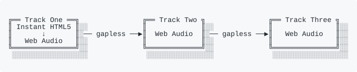

# Gapless.js

[](https://github.com/RelistenNet/gapless.js/actions/workflows/ci.yml)
[](https://bundlejs.com/?q=gapless&treeshake=[{+default+}])

Gapless audio player for the web. Takes an array of audio tracks and uses HTML5 audio with the Web Audio API to enable seamless, gapless transitions between tracks.

Though the earnest goal is not bundle-size driven, it has only one production dependency (xstate) so it operates in a rigid manner according to a well-designed state machine.

It has a dead simple API and is easy to get up and running.

Built for [Relisten.net](https://relisten.net), where playing back gapless live tracks is paramount.

**[Live Demo](https://gapless.saewitz.com)**

## Install

```bash
pnpm install gapless
```

## Quick Start

```javascript
import Queue from 'gapless';

const player = new Queue({
  tracks: [
    'https://example.com/track1.mp3',
    'https://example.com/track2.mp3',
    'https://example.com/track3.mp3',
  ],
  onProgress: (track) => {
    console.log(`${track.currentTime} / ${track.duration}`);
  },
  onEnded: () => {
    console.log('Queue finished');
  },
});

player.play();
```

## API

### Constructor Options (`GaplessOptions`)

```typescript
const player = new Queue({
  tracks: [], // Initial list of track URLs
  onProgress: (info) => {}, // Called at ~60fps while playing
  onEnded: () => {}, // Called when the last track ends
  onPlayNextTrack: (info) => {}, // Called when advancing to next track
  onPlayPreviousTrack: (info) => {}, // Called when going to previous track
  onStartNewTrack: (info) => {}, // Called whenever a new track becomes current
  onError: (error) => {}, // Called on audio errors
  onPlayBlocked: () => {}, // Called when autoplay is blocked by the browser
  onDebug: (msg) => {}, // Internal debug messages (development only)
  playbackMethod: 'HYBRID', // 'HYBRID' | 'HTML5_ONLY' | 'WEBAUDIO_ONLY'
  trackMetadata: [], // Per-track metadata (aligned by index)
  volume: 1, // Initial volume, 0.0–1.0
  preloadNumTracks: 2, // Number of tracks to preload ahead (0 to disable)
  playbackRate: 1, // Initial playback rate, 0.25–4.0
  repeat: 'off', // 'off' | 'all' | 'one'
});
```

### Methods

| Method                               | Description                                                      |
| ------------------------------------ | ---------------------------------------------------------------- |
| `play()`                             | Start or resume playback                                         |
| `pause()`                            | Pause playback                                                   |
| `togglePlayPause()`                  | Toggle between play and pause                                    |
| `next()`                             | Advance to the next track                                        |
| `previous()`                         | Go to previous track (restarts current track if > 8s in)         |
| `gotoTrack(index, playImmediately?)` | Jump to a track by index                                         |
| `seek(time)`                         | Seek to a position in seconds                                    |
| `setVolume(volume)`                  | Set volume (0.0–1.0)                                             |
| `setPlaybackRate(rate)`              | Set playback rate (0.25–4.0), reschedules gapless transitions    |
| `addTrack(url, options?)`            | Add a track to the end of the queue                              |
| `removeTrack(index)`                 | Remove a track by index                                          |
| `setRepeat(mode)`                    | `'off'`, `'all'` (loop the list) or `'one'` (loop the track)     |
| `resumeAudioContext()`               | Resume the AudioContext (for browsers that require user gesture) |
| `destroy()`                          | Clean up all resources                                           |

### Getters

| Getter              | Type                     | Description                                    |
| ------------------- | ------------------------ | ---------------------------------------------- |
| `currentTrack`      | `TrackInfo \| undefined` | Snapshot of the current track                  |
| `currentTrackIndex` | `number`                 | Index of the current track                     |
| `tracks`            | `readonly TrackInfo[]`   | Snapshot of all tracks                         |
| `isPlaying`         | `boolean`                | Whether the queue is playing                   |
| `isPaused`          | `boolean`                | Whether the queue is paused                    |
| `volume`            | `number`                 | Current volume                                 |
| `playbackRate`      | `number`                 | Current playback rate                          |
| `preloadNumTracks`  | `number`                 | Number of tracks to preload ahead (read/write) |
| `keys`              | `string[]`               | Entry keys in play order                       |
| `currentKey`        | `string \| null`         | Key of the current entry                       |
| `repeat`            | `RepeatMode`             | Current repeat mode                            |

### Editing the queue by key

Every entry has a stable `key`. Editing by key never interrupts the playing
entry, keeps decoded audio for entries that stay in the queue, and only
reschedules the gapless transition when the entry after the current one
changes.

```typescript
player.setEntries(
  [
    { key: 't1', url: 'https://example.com/1.mp3', metadata: { title: 'One' } },
    { key: 't2', url: 'https://example.com/2.mp3' },
  ],
  { startKey: 't1', startTime: 0, play: false }
);

player.insert([{ key: 'n1', url: 'https://example.com/n1.mp3' }], { after: 'current' });
player.move('t2', { after: 'start' }); // after: a key, 'current', 'start' or 'end'
player.remove('n1'); // removing the playing entry advances to the next one
player.goto('t2', { play: true, startTime: 30 });
```

`setEntries` reconciles by key. If the playing entry's key is still in the new
list, it keeps playing and `startKey` is ignored; otherwise playback moves to
`startKey`, or to the first entry.

The list is played in the order given. To shuffle, pass the entries in shuffled
order: the current entry keeps playing, and gapless follows the new order.

#### Repeat

- `'all'` loops the list. The wrap from the last entry to the first is gapless.
- `'one'` restarts the current entry when it ends and fires `onStartNewTrack`
  again. The restart is not sample-gapless. `next()` still moves on.

#### Snapshot and restore

```typescript
localStorage.queue = JSON.stringify(player.snapshot());
// { entries, currentKey, currentTime, repeat }

player.restore(JSON.parse(localStorage.queue)); // paused at the saved position
```

`snapshot()` keeps the URLs entries were created with, not redirect targets.

#### Change events

```typescript
const unsubscribe = player.onChange(({ keys, currentKey, repeat }) => {});
```

`onChange` fires when the order, the current entry or the repeat mode changes,
and not for progress, play/pause or seeks. It's called in a microtask after the
edit, once per edit, so a listener may edit the queue itself.

`addTrack`, `removeTrack` and `gotoTrack` still work by index. Entries added
with `addTrack` get a generated key, or pass `{ key }` in its options.

### `TrackInfo`

All callbacks and getters return `TrackInfo` objects — plain data snapshots with no methods:

```typescript
interface TrackInfo {
  index: number; // Position in the queue
  key: string; // Stable identity across reorders
  currentTime: number; // Playback position in seconds
  duration: number; // Total duration (NaN until loaded)
  isPlaying: boolean;
  isPaused: boolean;
  volume: number;
  trackUrl: string; // Resolved audio URL
  playbackType: 'HTML5' | 'WEBAUDIO';
  webAudioLoadingState: 'NONE' | 'LOADING' | 'LOADED' | 'ERROR';
  metadata?: TrackMetadata;
  playbackRate: number; // Current playback rate
  machineState: string; // Internal state machine state
}
```

### `AddTrackOptions`

```typescript
player.addTrack('https://example.com/track.mp3', {
  skipHEAD: true, // Skip HEAD request for URL resolution
  metadata: {
    title: 'Track Title',
    artist: 'Artist',
    album: 'Album',
    artwork: [{ src: 'https://example.com/art.jpg', sizes: '512x512', type: 'image/jpeg' }],
  },
});
```

### `TrackMetadata`

Metadata is used for the [Media Session API](https://developer.mozilla.org/en-US/docs/Web/API/Media_Session_API) (lock screen controls, browser media UI) and can contain arbitrary additional fields:

```typescript
interface TrackMetadata {
  title?: string;
  artist?: string;
  album?: string;
  artwork?: MediaImage[];
  [key: string]: unknown;
}
```

## Playback Method

The `playbackMethod` option controls how audio is rendered:

| Value                | Behavior                                                    | Use case                                                             |
| -------------------- | ----------------------------------------------------------- | -------------------------------------------------------------------- |
| `'HYBRID'` (default) | Starts with HTML5 audio, switches to Web Audio after decode | Remote files — instant playback + gapless transitions                |
| `'HTML5_ONLY'`       | HTML5 audio exclusively, no Web Audio                       | When Web Audio is unavailable or unwanted; gapless playback disabled |
| `'WEBAUDIO_ONLY'`    | Web Audio API exclusively, no HTML5 fallback                | Very small or local files where buffering is instant                 |

```javascript
// Web Audio only — waits for decode before playing
const player = new Queue({
  tracks: ['track1.mp3', 'track2.mp3'],
  playbackMethod: 'WEBAUDIO_ONLY',
});

player.play(); // Waits for decode, then plays via Web Audio
```

## Preload Count

Control how many tracks are preloaded ahead of the current track:

```javascript
const player = new Queue({
  tracks: ['a.mp3', 'b.mp3', 'c.mp3', 'd.mp3'],
  preloadNumTracks: 1, // Only preload 1 track ahead (default: 2)
});

// Can also be changed at runtime:
player.preloadNumTracks = 0; // Disable preloading
player.preloadNumTracks = 3; // Preload 3 ahead
```

## Playback Rate

Control the speed of playback (0.25x to 4x). Gapless scheduling automatically adjusts for the current rate:

```javascript
const player = new Queue({
  tracks: ['a.mp3', 'b.mp3'],
  playbackRate: 1.5, // Start at 1.5x
});

player.play();
player.setPlaybackRate(2); // Change to 2x mid-playback
console.log(player.playbackRate); // 2
```

## Migration from v3

v4 is a complete rewrite. The public API has changed:

| v3                                      | v4                                                    |
| --------------------------------------- | ----------------------------------------------------- |
| `import GaplessQueue from 'gapless.js'` | `import Queue from 'gapless'` (or `import { Queue }`) |
| `player.playNext()`                     | `player.next()`                                       |
| `player.playPrevious()`                 | `player.previous()`                                   |
| `player.resetCurrentTrack()`            | `player.seek(0)`                                      |
| `player.disableWebAudio()`              | Pass `playbackMethod: 'HTML5_ONLY'` in constructor    |
| `player.nextTrack`                      | `player.tracks[player.currentTrackIndex + 1]`         |
| `track.completeState`                   | Callbacks now receive `TrackInfo` objects             |
| Callbacks receive Track instances       | Callbacks receive plain `TrackInfo` data snapshots    |

### Key differences

- **State machines**: Internally uses [XState](https://xstate.js.org/) for queue and track state management. XState is bundled — no extra dependency needed.
- **ESM only**: Published as ES module only. No CommonJS build.
- **TrackInfo**: All callbacks and getters return plain data objects (`TrackInfo`) instead of Track class instances.
- **Media Session**: Built-in support for the Media Session API via `trackMetadata`.
- **Volume**: Volume is now set via `setVolume(n)` and readable via the `volume` getter.

## License

MIT
